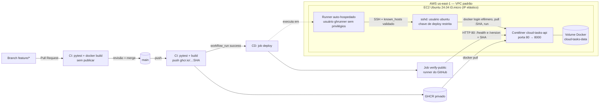

# Relatório — Esteira CI/CD da Cloud Tasks API na AWS

**Guilherme Brasil**  
**Gabriel Rodrigues**  
**Gabriel Gonçalves**

Computação em Nuvem

---

## 1. Entregáveis

| Item | Link |
|---|---|
| Repositório | https://github.com/guilherme-brasil-cst/cloud-tasks-cicd |
| Aplicação (EC2) | http://52.23.142.189/health — `/version`, `/tasks` |
| Pull Request com CI aprovada (funcionalidades) | https://github.com/guilherme-brasil-cst/cloud-tasks-cicd/pull/2 |
| Pull Request com CI aprovada (CD) | https://github.com/guilherme-brasil-cst/cloud-tasks-cicd/pull/1 |
| CI aprovada em PR | https://github.com/guilherme-brasil-cst/cloud-tasks-cicd/actions/runs/41054533509 |
| CI na `main` com publicação no GHCR | https://github.com/guilherme-brasil-cst/cloud-tasks-cicd/actions/runs/41055686405 |
| CD aprovado (deploy + `/health` + `/version`) | https://github.com/guilherme-brasil-cst/cloud-tasks-cicd/actions/runs/41055796337 |
| Prova de persistência | https://github.com/guilherme-brasil-cst/cloud-tasks-cicd/actions/runs/41686230429 |
| Segundo deploy automático (merge do PR #3, documentação) | https://github.com/guilherme-brasil-cst/cloud-tasks-cicd/actions/workflows/cd.yml |
| Todos os CDs | https://github.com/guilherme-brasil-cst/cloud-tasks-cicd/actions/workflows/cd.yml |
| Testes manuais em produção | docs/TESTES_PRODUCAO.md |
| Roteiro da apresentação e encerramento | docs/APRESENTACAO.md |
| Prints da configuração na AWS | [Prints/](../Prints/README.md) |

## 2. Arquitetura



Fluxo: o desenvolvimento acontece em branches `feature/...`. O PR executa apenas testes e build, sem publicar imagem e sem deploy. O merge na `main` executa a CI completa, que publica `ghcr.io/guilherme-brasil-cst/cloud-tasks-cicd:<SHA>`. A conclusão com sucesso dessa CI dispara o CD por `workflow_run`. O CD implanta exatamente a imagem do commit e valida `/health` e `/version`.

## 3. Infraestrutura AWS

| Recurso | Configuração |
|---|---|
| Região / rede | us-east-1, VPC padrão, sub-rede pública |
| Instância | EC2 `t3.micro`, Ubuntu Server 24.04 LTS (x86_64), AMI oficial da Canonical |
| Disco | EBS gp3 8 GiB, **criptografado**, excluído junto com a instância |
| Endereço | IP elástico 52.23.142.189 (não muda quando o laboratório reinicia a instância) |
| Metadados | IMDSv2 obrigatório |
| Perfil IAM | `LabInstanceProfile` do Learner Lab, usado para administração via AWS Systems Manager (sem SSH externo) |
| Bootstrap | `infra/user-data.sh`: instala Docker, cadastra a chave de deploy e cria o usuário do runner |

Os prints da configuração no Console da AWS e no CloudShell estão na pasta [Prints/](../Prints/README.md).

### Security Group `cloud-tasks-sg`

| Direção | Protocolo/Porta | Origem/Destino | Motivo |
|---|---|---|---|
| Entrada | TCP 80 | 0.0.0.0/0 | Acesso HTTP à API (docente e checagem externa do CD) |
| Entrada | TCP 22 | **nenhuma regra** | SSH não é exposto à internet |
| Saída | Todas | 0.0.0.0/0 | GitHub (runner), GHCR (pull) e repositórios de pacotes |

## 4. Decisões técnicas e segurança

**Deploy sem abrir a porta 22.** Os runners hospedados do GitHub não têm IP fixo, e o enunciado proíbe liberar SSH para `0.0.0.0/0`. O guia sugere um runner auto-hospedado em rede permitida, e foi essa a solução adotada. O runner foi instalado na própria EC2, com conexão somente de saída (HTTPS) para o GitHub. O job `deploy` usa `runs-on: [self-hosted, linux, x64, ec2-deploy]`.

**Separação de privilégios.** O runner roda como `ghrunner`: sem `sudo` e fora do grupo `docker`, cuja participação equivale a root. Para mexer nos contêineres, o runner precisa fazer SSH até o usuário `ubuntu` com a chave de deploy. Assim o fluxo do starter foi mantido (SSH + `known_hosts` + `deploy.sh`), e a chave virou a fronteira de privilégio.

**Chave de deploy.** É um par ed25519 exclusivo para o pipeline. A chave pública está no `authorized_keys` com a opção `restrict` (sem pty e sem encaminhamento de portas ou agente). A chave privada existe apenas no secret `EC2_SSH_KEY`. Durante o job ela é gravada em `$RUNNER_TEMP` com `umask 077` e apagada ao final, mesmo em caso de falha.

**`known_hosts` confiável.** A chave pública do host foi lida pela API da AWS (`get-console-output`, bloco *SSH HOST KEY KEYS* do cloud-init), não por `ssh-keyscan`. O SSH roda com `StrictHostKeyChecking=yes`.

**Imagem imutável e GHCR privado.** Como o repositório é privado, o pacote também é. Em vez de deixar credenciais permanentes na EC2, o CD envia o `GITHUB_TOKEN` do próprio job pela entrada padrão do SSH. Esse token tem só `packages: read` e expira ao fim do job. Ele é usado no `docker login` e descartado com `docker logout` logo após o pull.

**Secrets e variables.** Tudo está configurado em *Settings → Secrets and variables → Actions*:
- Secrets: `EC2_HOST`, `EC2_SSH_KEY` e `EC2_KNOWN_HOSTS`.
- Variables: `EC2_USER` e `PUBLIC_HOST`.

O environment `production` aceita deploy somente a partir da `main`, e os jobs de deploy usam `concurrency` para nunca rodarem em paralelo. Nada sensível aparece nos logs: o GitHub mascara os valores como `***`.

**Integridade do runner.** O pacote do runner é baixado da release oficial e conferido contra o SHA-256 publicado (`scripts/setup-runner-ec2.sh`).

**Verificação dupla.** O job `deploy` checa `/health` de dentro da VPC. O job `verify-public` roda em um runner do GitHub, fora da AWS. Ele confere pela internet que `/health` responde e que `/version` é igual ao SHA do commit implantado.

## 5. Evolução funcional

| Mudança | Comportamento | Testes |
|---|---|---|
| `DELETE /tasks/<id>` | 204 ao excluir; 404 se não existir | `test_delete_existing_task_returns_204`, `test_delete_missing_task_returns_404`, `test_delete_twice_returns_404_second_time` |
| `GET /version` | Retorna o SHA do commit, injetado no build (`GIT_SHA` → `APP_VERSION`) | `test_version_reports_configured_value` |
| `GET /tasks?done=true\|false` | Filtra por situação; valor inválido → 400 | `test_filter_tasks_by_status`, `test_filter_rejects_invalid_value` |

Ao todo são 11 testes automatizados (5 originais e 6 novos), executados em todo PR e em todo push na `main`.

## 6. Evidências

**CD aprovado** (run 41055796337, commit `da41b55`), trechos do log:

```
Implantando ghcr.io/guilherme-brasil-cst/cloud-tasks-cicd:da41b55c43ce2f072432ab9ad05b8093c56fcf5d
Deploy succeeded: ghcr.io/guilherme-brasil-cst/cloud-tasks-cicd:da41b55c43ce2f072432ab9ad05b8093c56fcf5d
{"status":"ok"}
Versao publicada: da41b55c43ce2f072432ab9ad05b8093c56fcf5d
```

O job `deploy` rodou no runner `ec2-cloud-tasks` e o `verify-public` em um runner hospedado do GitHub.

**PR não publica nem implanta.** Nos runs de PR (ex.: 41054533509), os passos *Publish immutable image* e *Authenticate to GHCR* aparecem como *skipped*, e nenhum CD é disparado.

**Persistência após recriar o contêiner** (workflow *Prova de persistencia*):

Run 41686230429, executado em 03/11 depois que a instância foi religada por uma nova sessão do laboratório:

```
Imagem em execucao: ghcr.io/guilherme-brasil-cst/cloud-tasks-cicd:da41b55c43ce2f072432ab9ad05b8093c56fcf5d
{"done":false,"id":1,"title":"persistencia-20261103T173853Z"}
--- Recriando o conteiner ---
Conteiner antigo: d461d370898d | novo: b32bf61417c0
--- Tarefas apos recriacao ---
[{"done":false,"id":1,"title":"persistencia-20261103T173853Z"}]
OK: dados persistiram no volume cloud-tasks-data
```

O log também mostra que a instância voltou sozinha depois de ser desligada pelo fim da sessão anterior, já servindo a mesma imagem (`--restart unless-stopped`), e que o runner reconectou ao GitHub como serviço. O contêiner é removido (`docker rm -f`) e criado de novo com a mesma imagem e o mesmo volume `cloud-tasks-data`. A tarefa criada antes continua listada em `/tasks`.

## 7. Custos e encerramento

O trabalho foi executado no **AWS Academy Learner Lab**, que usa créditos da disciplina. Os valores de referência on-demand em us-east-1 são:

| Recurso | Preço de referência | 24 h × 30 dias |
|---|---|---|
| EC2 t3.micro | US$ 0,0104/h | ≈ US$ 7,59 |
| IPv4 público (IP elástico) | US$ 0,005/h | ≈ US$ 3,65 |
| EBS gp3 8 GiB | US$ 0,08/GiB-mês | ≈ US$ 0,64 |
| GitHub Actions / GHCR | Cota gratuita da conta | US$ 0 |
| **Total máximo** | | **≈ US$ 11,88/mês** |

Na prática, a instância só fica ligada durante as sessões do laboratório. O IP elástico e o disco continuam sendo cobrados mesmo com a instância parada. Por isso, **depois da apresentação** todos os recursos são excluídos com `infra/teardown.sh`, executado no CloudShell. O script:
1. desassocia e libera o IP elástico;
2. termina a instância (o volume EBS é apagado junto);
3. exclui o Security Group;
4. lista volumes remanescentes com a tag `Project=cc-cicd`, para conferência.

Além disso, o runner é removido em *Settings → Actions → Runners*.

## 8. Dificuldades encontradas

1. **SSH a partir do runner hospedado.** Os primeiros CDs na `main` falharam (runs 41053865390 e 41054574935), porque o runner do GitHub não alcança a instância sem a porta 22 aberta. A solução foi o runner auto-hospedado (PR #1), sem expor SSH.
2. **Ordem dos merges.** O novo CD valida `/version`. Por isso o PR #2, que cria essa rota, foi integrado antes do PR #1. O CD do merge do PR #2 ainda usou o workflow antigo e falhou pelo mesmo motivo do item 1 (run 41055677714).
3. **Repositório privado.** O pacote no GHCR passou a ser privado, então a EC2 não consegue baixar a imagem de forma anônima, como previa o guia. A solução foi o `docker login` com o token efêmero do job.
4. **Sessões do Learner Lab.** A sessão expira e a instância é desligada. O IP elástico manteve o endereço fixo entre sessões. O contêiner (`--restart unless-stopped`) e o runner (serviço systemd) voltam sozinhos quando a instância liga.

## 9. Integrantes e distribuição das tarefas

| Integrante | Responsabilidades |
|---|---|
| Guilherme Brasil | Infraestrutura AWS (EC2, Security Group, IP elástico, runner), workflows de CI/CD, implementação das rotas e testes, deploy |
| Gabriel Rodrigues | Testes manuais da API em produção, execução da prova de persistência (docs/TESTES_PRODUCAO.md) e revisão do PR de apresentação |
| Gabriel Gonçalves | Roteiro da apresentação, checklist de encerramento dos recursos AWS (docs/APRESENTACAO.md) e revisão do PR de testes em produção |
